# Walkthrough: from an empty database to a redeemed voucher

A complete pass through Talon, captured against a freshly created database. The scenario is a
winterization cash transfer in Jordan: three vendors, twelve households in one cycle, two voucher
categories, distributed and then partly redeemed.

Every screenshot below is of the running application, and every figure in them was produced by the
workflow described — nothing is mocked up. All names, numbers and identifiers are fabricated.

If you want the reasoning behind each step rather than the sequence,
[Operating a programme](operate.html) covers the same ground.

---

## 1. Sign in

The client is served from `/app/`, and `/` redirects to it.

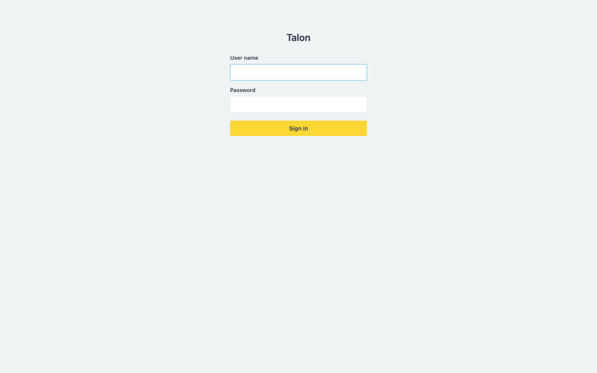

---

## 2. Create the country

System Administration → Reference Data → Countries. Almost everything in Talon is scoped to a
country, so this comes first.

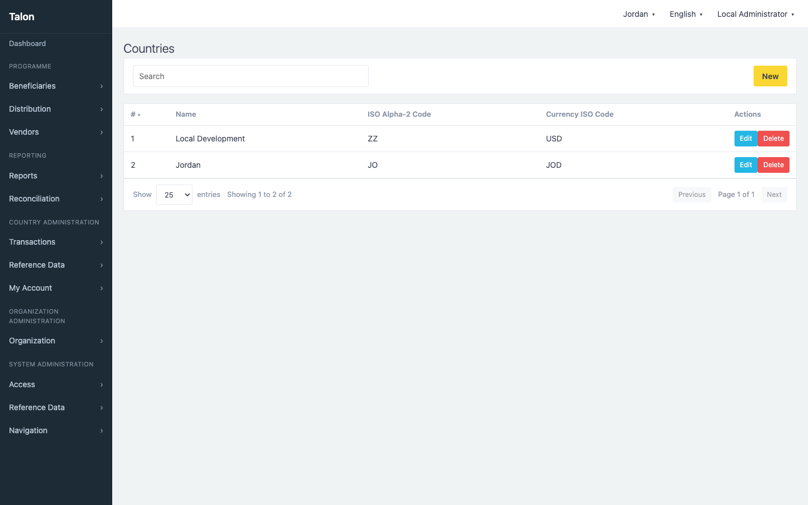

The ISO code earns its keep later: it is what the inbound redemption webhook is keyed on, so `JO`
means a gateway posts to `/api/VoucherWorkflow/ValidateTransactionSMS/JO`. The calling code and
currency symbol flow into every form and report that follows.

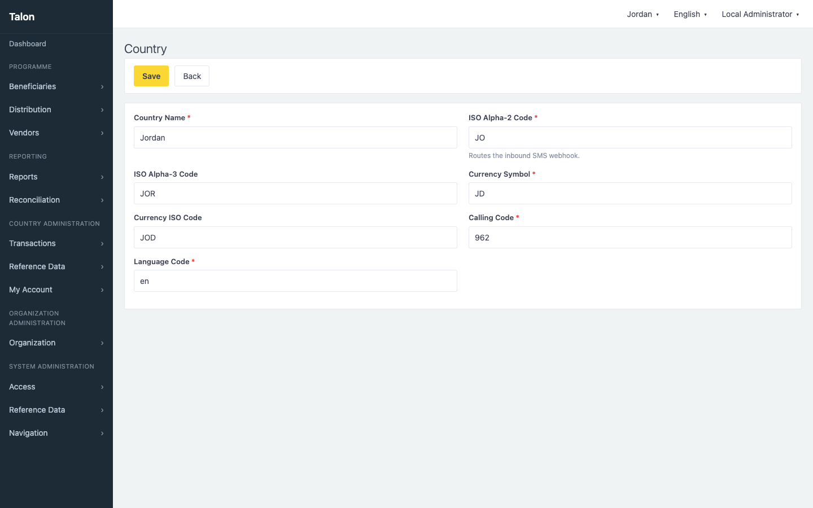

Then link your organisation to the country and grant your user access to it. Until you do, it will
not appear in the country switcher in the header, and none of the screens below will show it.

{: .note }
> A fresh install seeds a "Local Development" country so there is something to look at. Leave it or
> delete it; it is not load-bearing.

---

## 3. Country reference data

Locations, vendor types and voucher types are all country-scoped.

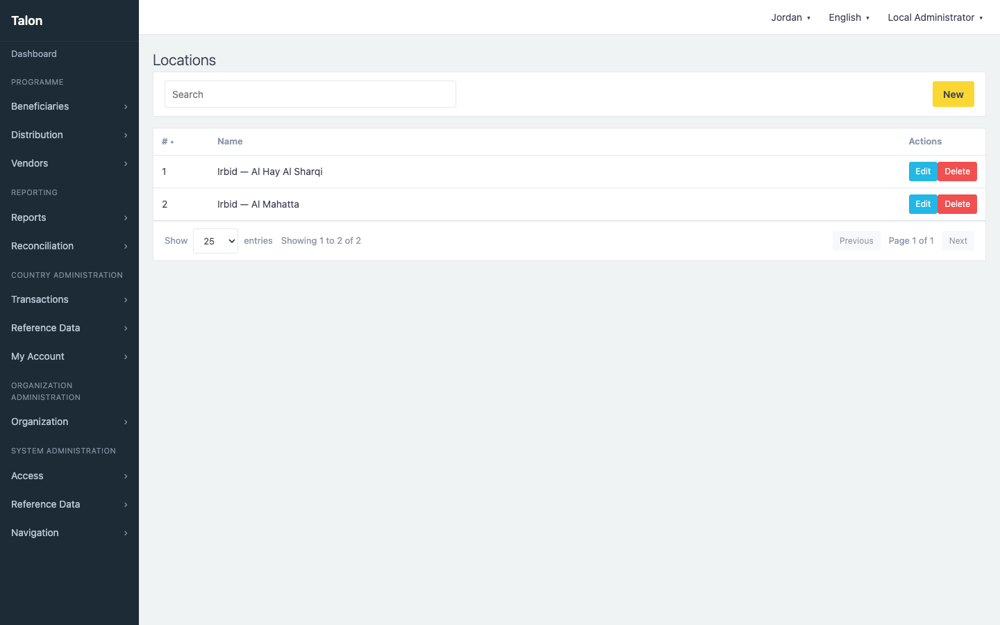

Vendor types are worth a moment's thought rather than being filled in by rote. A voucher category can
be restricted to one, and that restriction — checked at redemption — is the mechanism that stops a
food voucher being spent at a pharmacy.

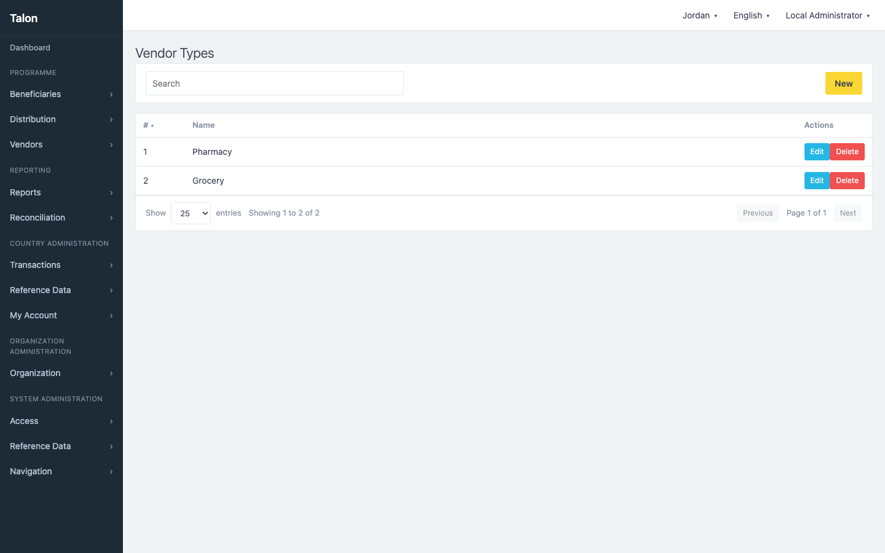

---

## 4. Register vendors

Three vendors: two groceries and a pharmacy.

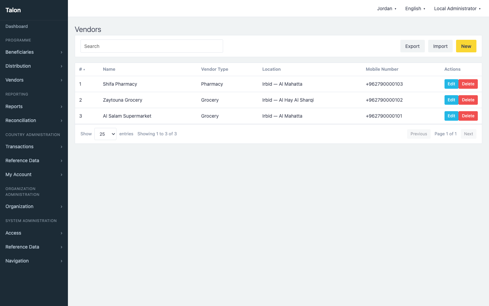

The vendor form picks up the country's `+962` calling code and offers the types and locations defined
in the previous step. **The mobile number matters more than anything else on this form** — it is the
vendor's identity at redemption, whichever channel the redemption arrives on.

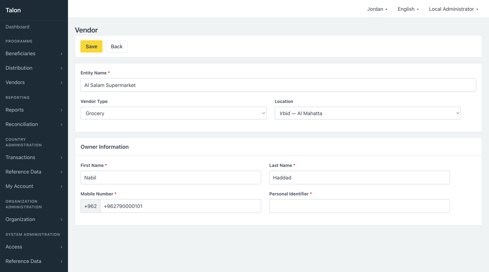

---

## 5. Register households

First the cycle — the cohort you will distribute to as a unit.

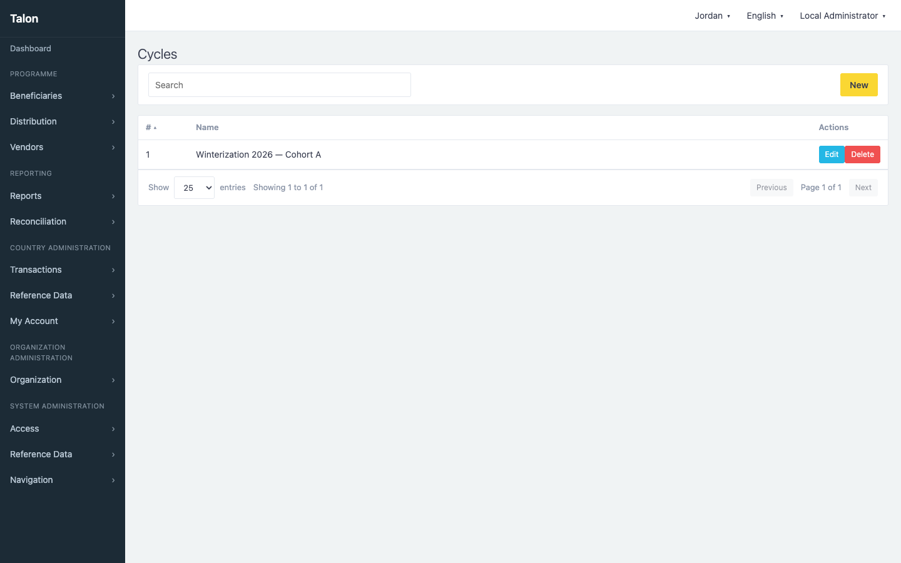

Then the households in it. Twelve here; in real use these arrive through the Excel import on this
screen rather than one at a time.

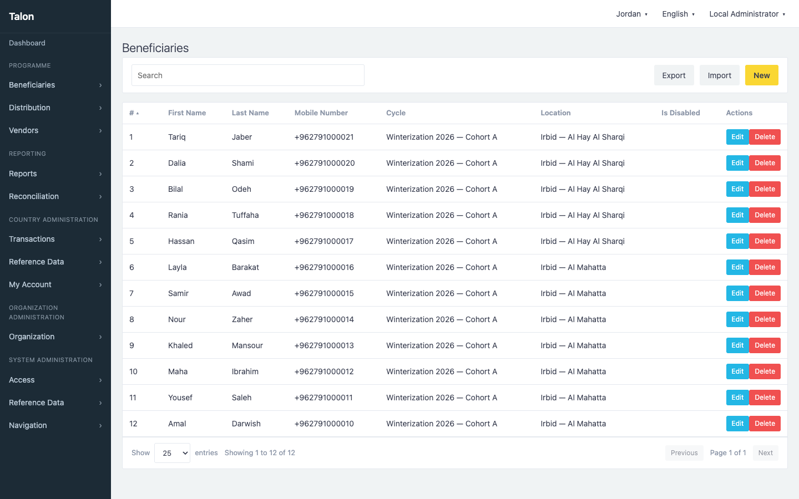

Each household carries a **personal identifier**, which is the number a vendor quotes back to confirm
the right person is being served. **Generate** issues a random 8–10 digit number, unique within the
country, rather than recording a government document number — many of the people a cash programme
reaches have no such document, and putting a real one into a database that a vendor reads aloud
creates a protection problem for no benefit.

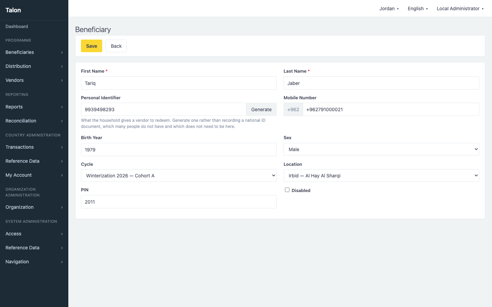

---

## 6. Define the programme

A programme carries the fund code, the distribution mechanism and the voucher code length.

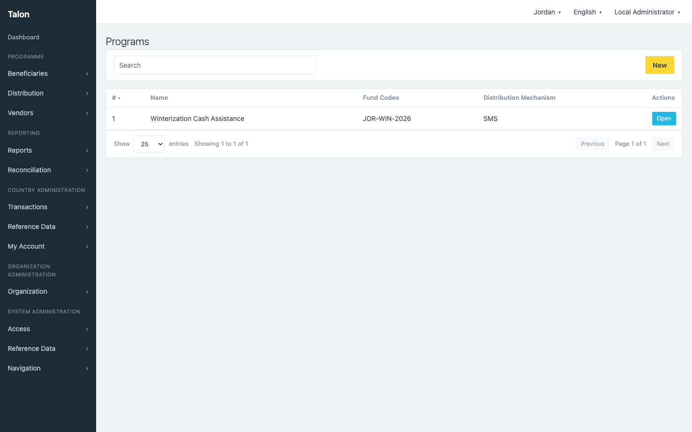

Its voucher categories decide what each household receives and where it can be spent — here 75 JOD of
food and 25 JOD of hygiene, both restricted to grocery vendors. Two categories means each household
receives two vouchers.

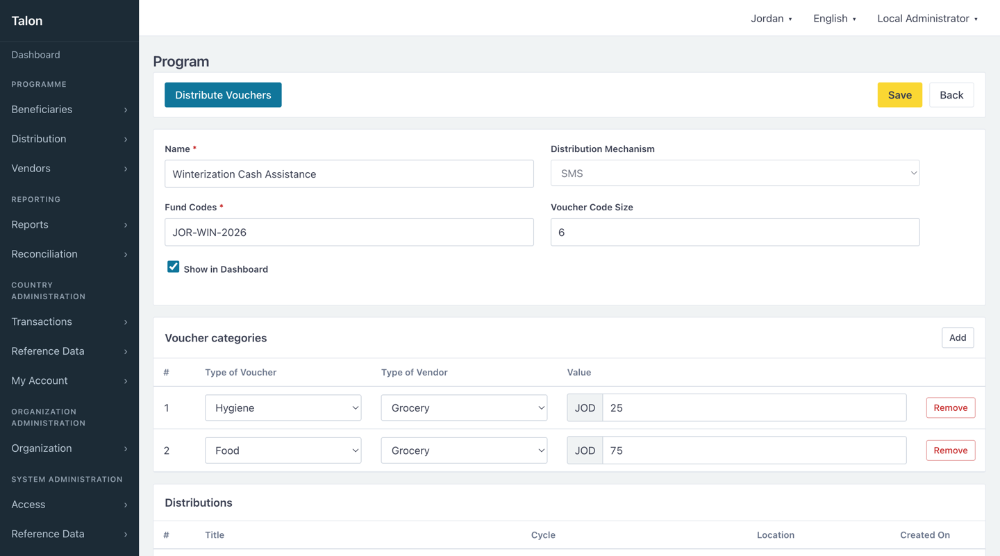

{: .note }
> Six digits is the default code length and a million possible codes. That is short enough to read out
> over a bad line, and short enough that guessing is worth thinking about before you issue at scale —
> see [Security](security.html#voucher-code-entropy).

---

## 7. Distribute

Distributing asks only for the cycle and the location. Behind that one action Talon creates the
distribution, copies the programme's categories onto it, generates a unique code for every voucher,
and issues one voucher per category per household — 24 vouchers, 12 at 75 JOD and 12 at 25 JOD.

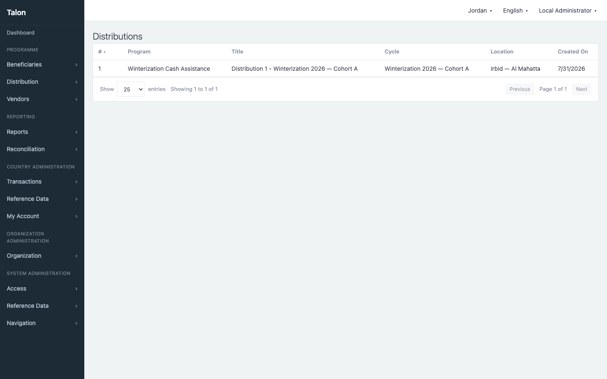

The distribution's own screen splits unused from used and lists the households, with the actual codes.
Vouchers can be re-sent or cancelled from here.

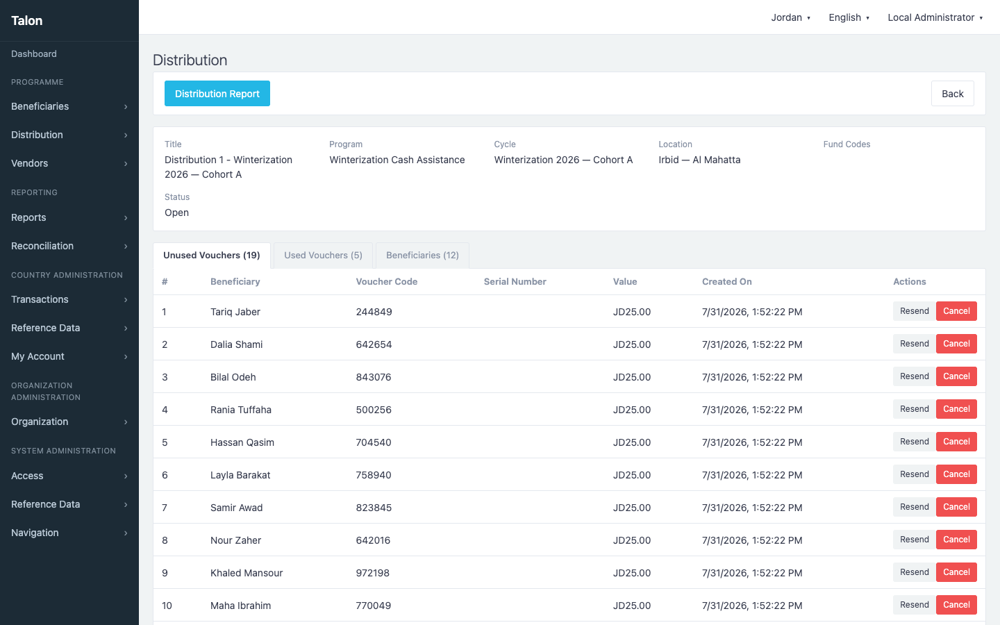

---

## 8. Redeem

A vendor sends the voucher code and the household's personal identifier from their registered number:

```
535635 6569004891
```

Talon reads the last two whitespace-separated tokens, so a human prefix is tolerated. It resolves the
country, matches the sender to a vendor, finds the voucher, checks the vendor's type against the
category's restriction, compares the identifier against the household's record, records the
redemption, and sends back a six-digit confirmation code.

**It does not matter which channel this arrives on.** A text posted by an SMS gateway and a reply to
the Telegram bot go through the same rules. How messages travel is a per-country setting, and a
country holds an ordered chain rather than a single channel, so it can reach enrolled recipients on a
free channel and text everyone else.

The same screen holds the wording of every message Talon sends. **Talon ships no default wording**,
so this has to be filled in before the first distribution — vouchers issued against empty templates
are still valid, but nobody is told their code. Writing them is covered in
[Messaging](MESSAGING.html#message-templates).

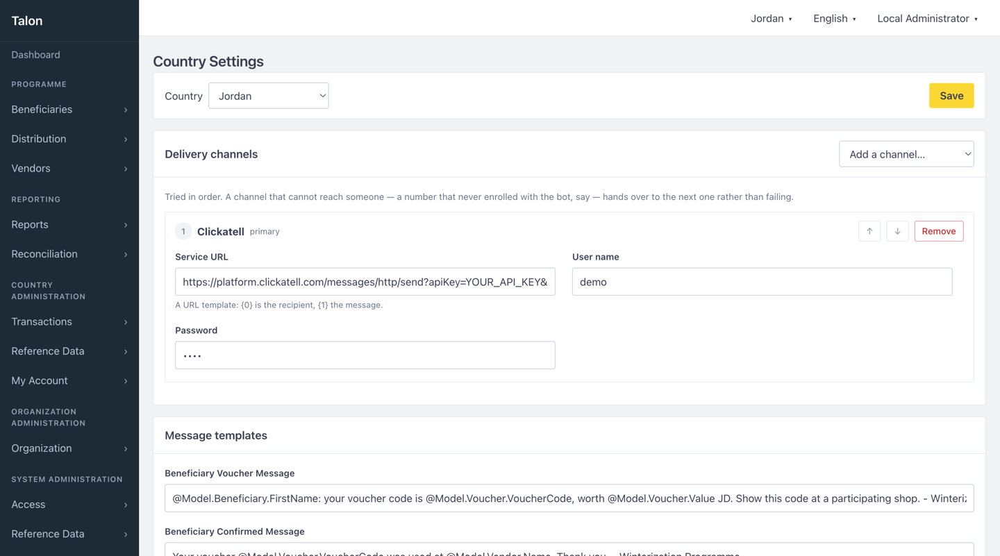

Every message Talon sends is recorded with its recipient, its state and the number of attempts it
took — here, the 24 voucher codes going out to the twelve households. That record is what makes a
disputed redemption possible to investigate, and a delivery that never arrived possible to notice.

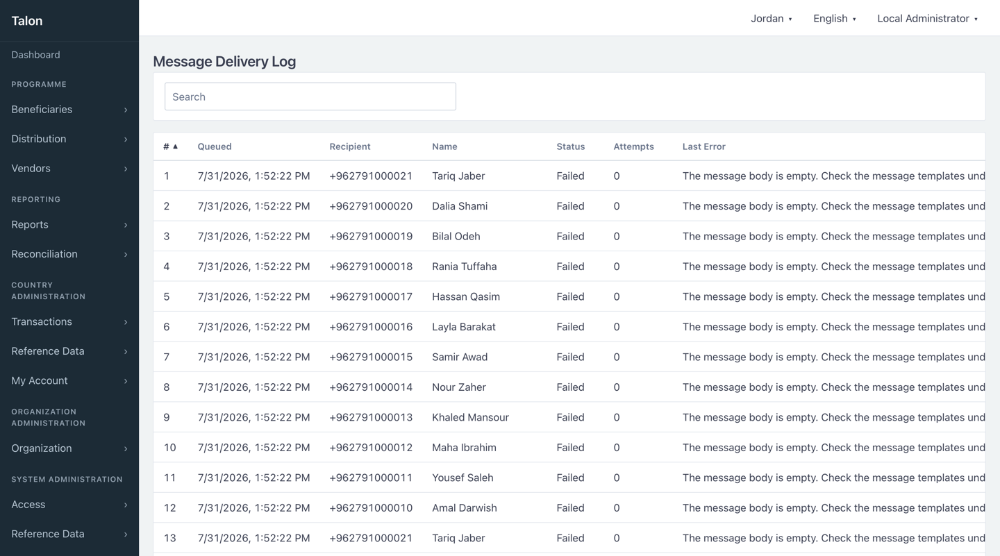

---

## 9. Watch it land on the dashboard

12 households, 24 vouchers issued worth JD 1,200, five redeemed for JD 375, broken out by location and
vendor count. It updates live over SignalR.

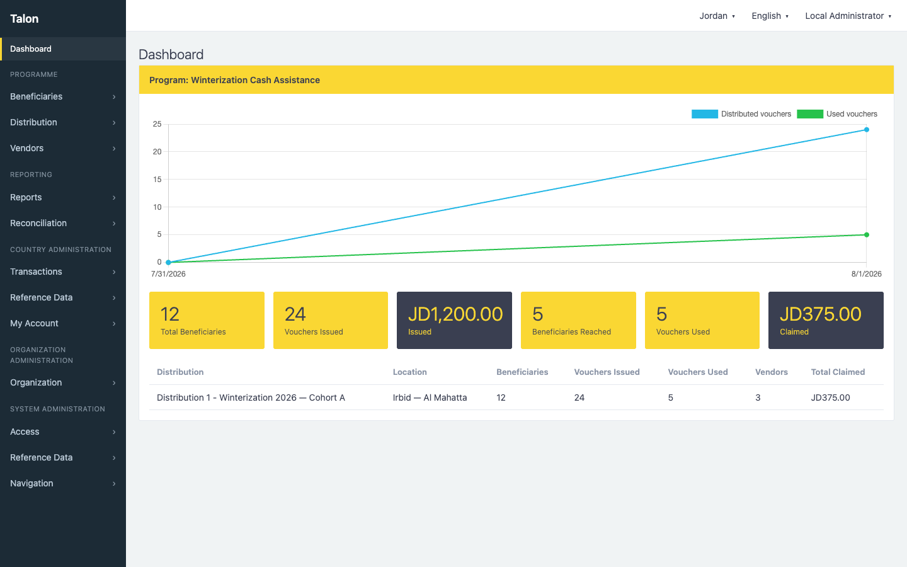

---

## 10. Pay the vendor

Redeeming a voucher tells you a vendor is owed money. Paying them is a separate act, and it happens
here. Pick the vendor and the programme, and Talon lists what they have redeemed and not yet been
paid for — five vouchers, JD 375.

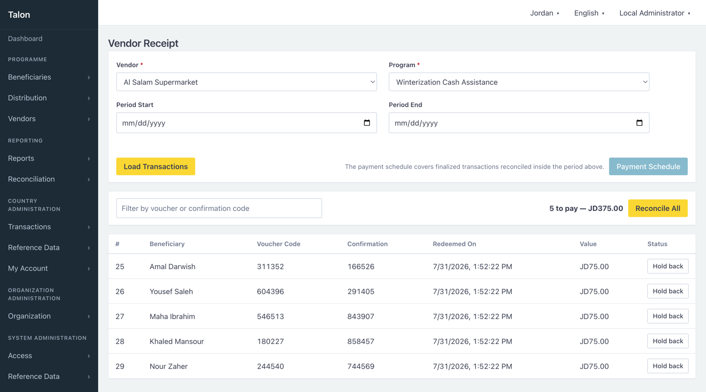

Anything disputed can be held back: it drops out of the total and simply stays outstanding for a
later run. **Reconcile All** then records who agreed to pay the rest, and when.

That is an agreement, not a payment, so it is deliberately not the last step. Issuing the receipt is
what finalizes those transactions — it produces the document the vendor signs, and only finalized
transactions appear on the payment schedule that finance works from.

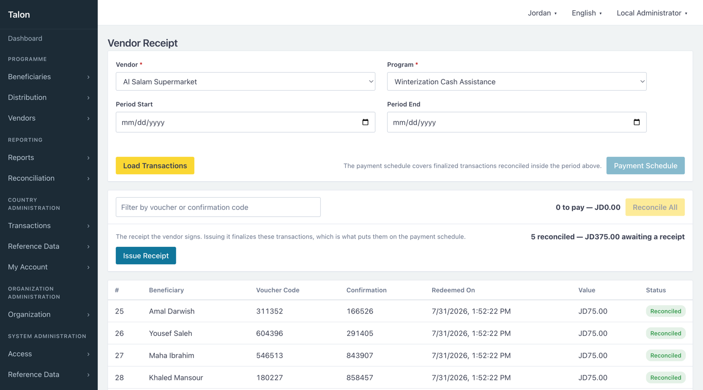

The order matters and the screen now states it, because reconciling and then going straight to the
payment schedule produces a spreadsheet with nothing on it.

---

## 11. Account for the distribution

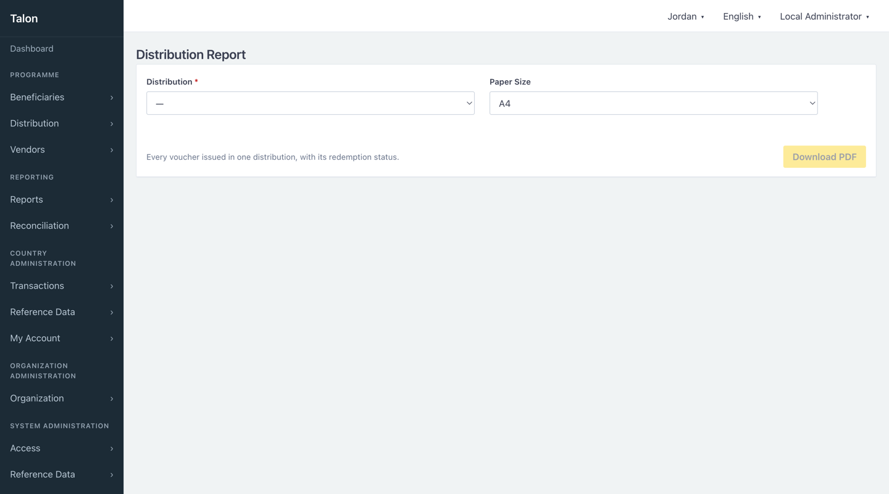

The distribution report is the document that accounts for a distribution. Every household appears
with both vouchers; the five redemptions carry their claim codes; totals are in the country's
currency.

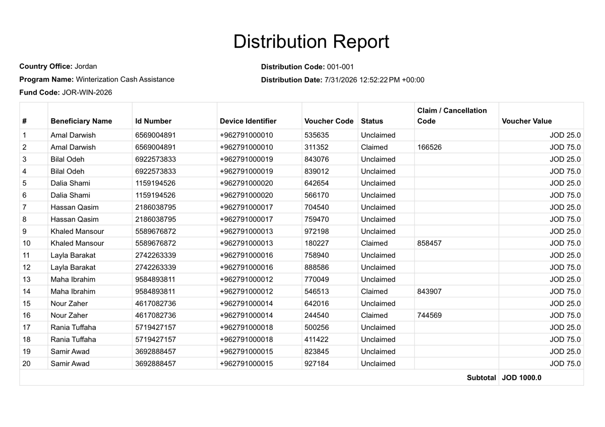

Reports render a Razor template to HTML and convert it with headless Chromium, which is the one part
of Talon that wants real memory — see [Sizing](deploy.html#sizing).

---

## Reproducing this

The screens above were driven through the browser; the bulk records — the extra vendors, the twelve
households, the redemptions — were created through the same API the client uses.

The equivalent flow runs headlessly in `TalonAdmin.Tests/VoucherDistributionScenarioTests`: it builds
a country, a programme and a cycle, distributes, redeems by SMS, and asserts that the dashboard and
the report agree, in about two seconds.
