# Walkthrough: from an empty database to a redeemed voucher

A complete pass through Talon on the migrated .NET 10 stack, captured against a freshly created
database. The scenario is a winterization cash transfer in Jordan: three vendors, twelve
households in one cycle, two voucher categories, distributed and then partly redeemed by SMS.

All names, numbers and identifiers below are fabricated demo data.

> **The screenshots predate the Vue 3 cutover** and show the AngularJS client that used to serve
> `/app/`. Every step, field and figure still matches — the screens were ported like for like — but
> the chrome looks different. They have not been recaptured yet.

## 1. Sign in

The client is served from `wwwroot/app`; `/` redirects to it.

## 2. Create the country

System Administration → Reference Data → Countries → New. The ISO code drives the SMS webhook
route, and the calling code and currency symbol flow through into every form and report that
follows.

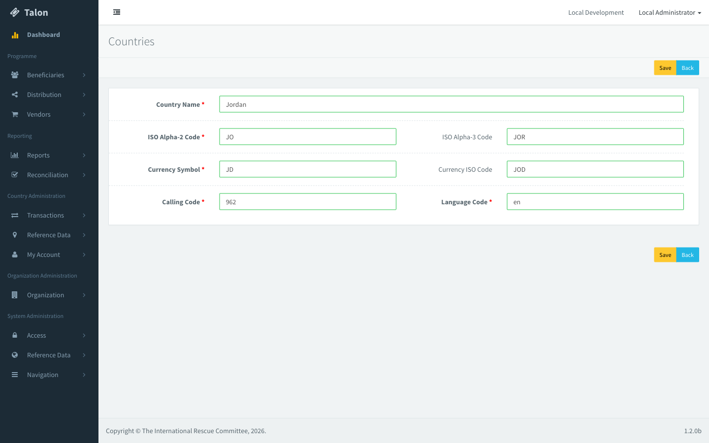

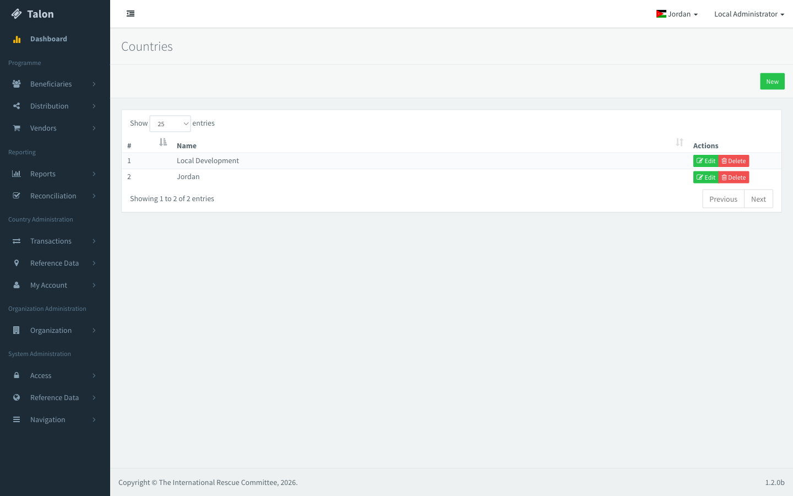

Once the organisation is linked to the country and the user is granted access to it, Jordan
appears in the country switcher in the header — the flag and the active tenant come from the row
just created.

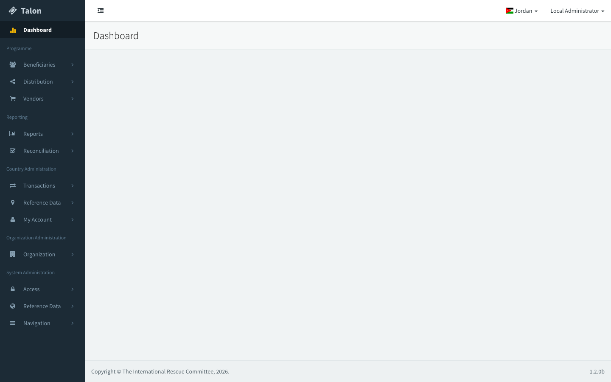

## 3. Country reference data

Locations, vendor types and voucher types are all country-scoped. Everything created from here on
is filtered by the active tenant.

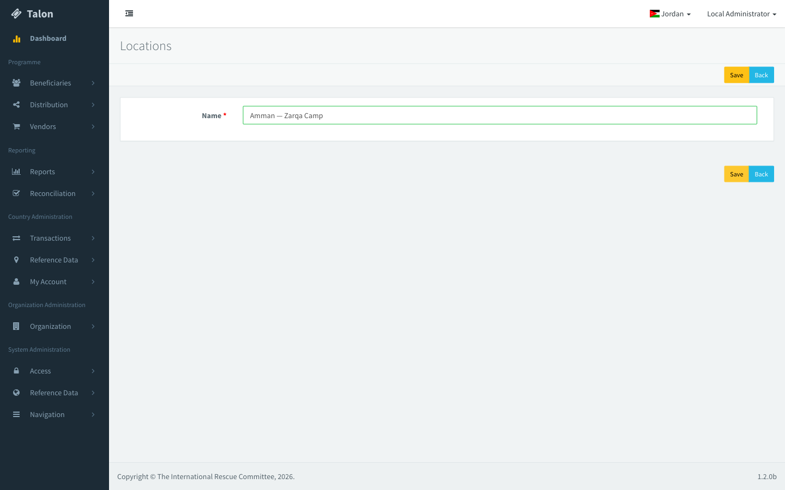

## 4. Register vendors

The vendor form picks up the country's `+962` calling code and offers the vendor types and
locations defined in the previous step.

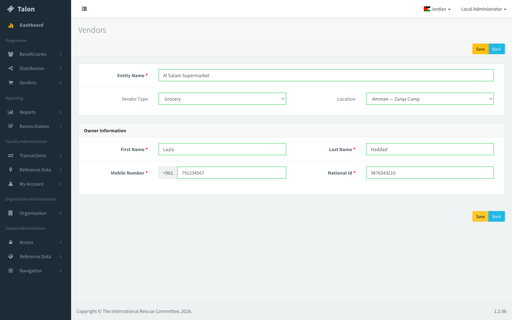

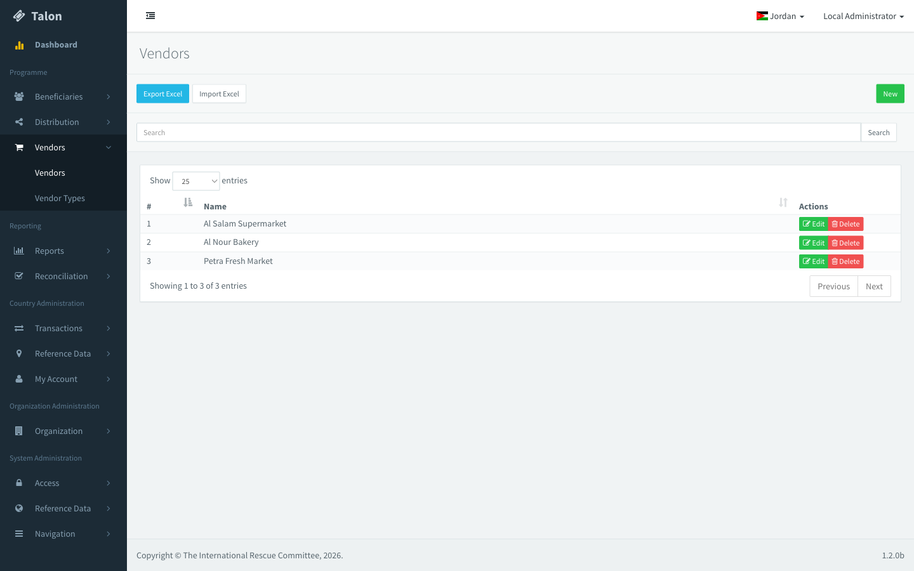

## 5. Register beneficiary households

Twelve households in a single cycle ("Winterization 2026 — Cohort A"). In real use these arrive
through the Excel import on this screen rather than one at a time.

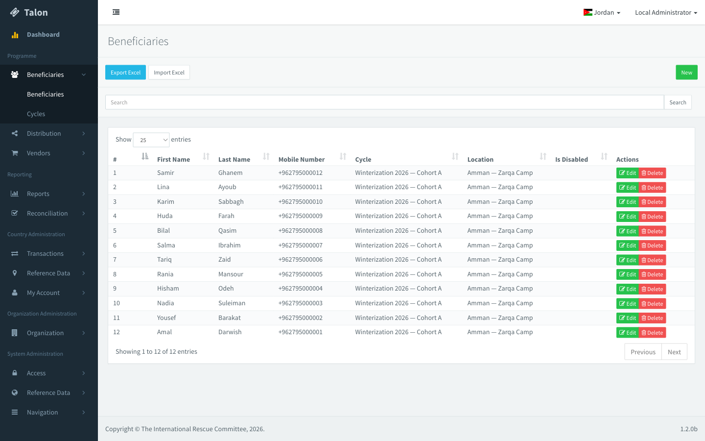

## 6. Define the programme

A programme carries the fund code, the distribution mechanism and the voucher code length.

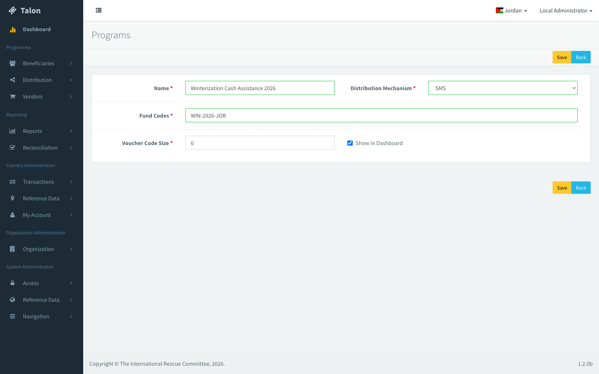

Its voucher categories decide what each household receives and where it can be spent — here
75 JOD of food and 25 JOD of hygiene, both redeemable at grocery vendors. Values are shown in the
country's currency.

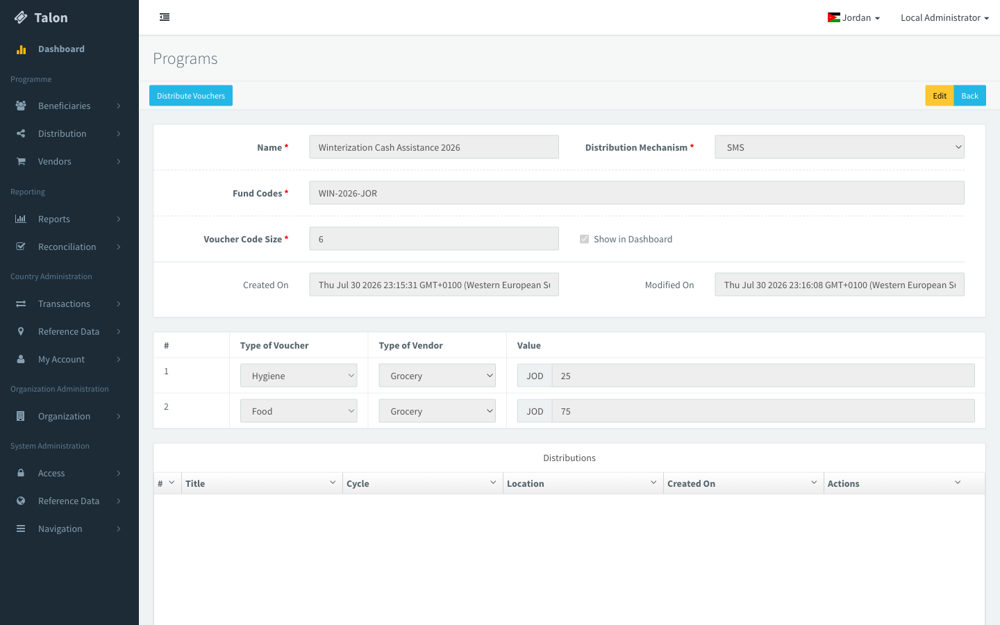

## 7. Distribute

"Distribute Vouchers" asks only for the cycle and the location.

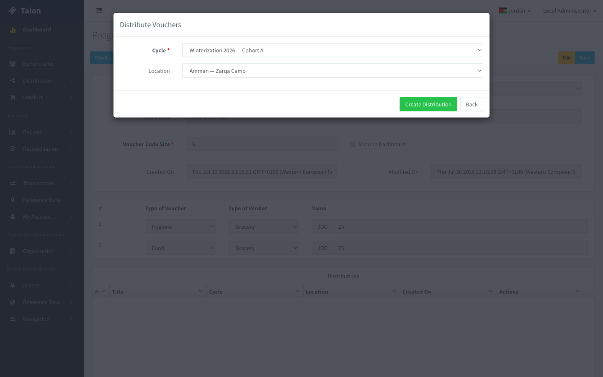

Behind that one click the server creates the distribution, copies the programme's categories onto
it, generates a unique code for every voucher, and issues one voucher per category per household —
24 vouchers, 12 at 75 JOD and 12 at 25 JOD.

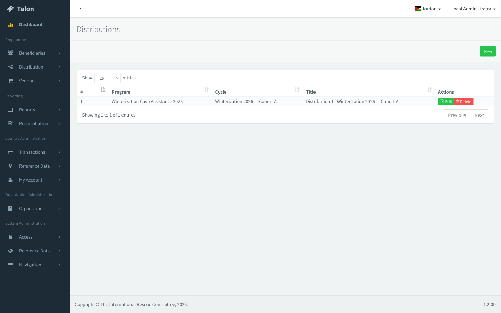

## 8. Redeem by SMS

A vendor texts the voucher code and the beneficiary's ID number from their registered number. The
gateway posts it to `/api/VoucherWorkflow/ValidateTransactionSMS/JO`, which resolves the country
from the ISO code, matches the vendor by mobile number, and settles the voucher.

Five households redeemed their food voucher at Al Salam Supermarket.

## 9. Watch it land on the dashboard

12 households, 24 vouchers issued worth JD 1,200, five redeemed for JD 375 — with the
distribution broken out by location and vendor count.

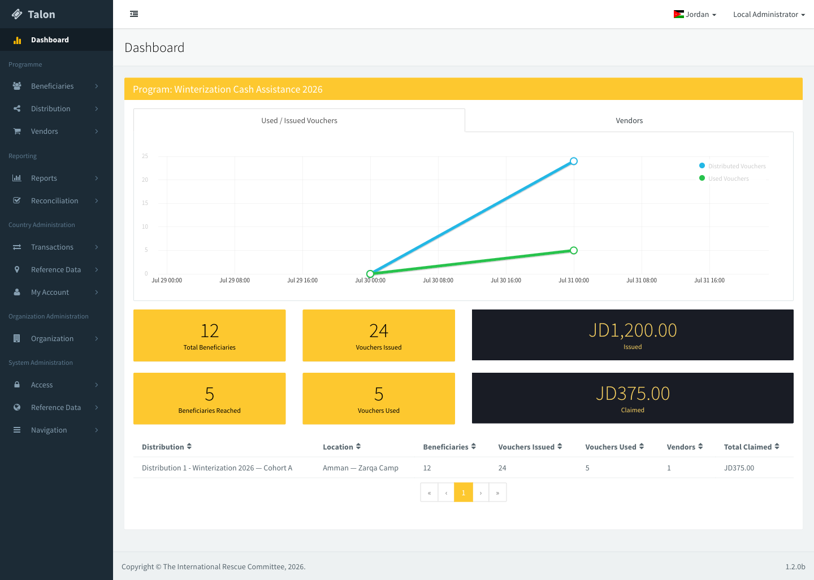

## 10. Reports

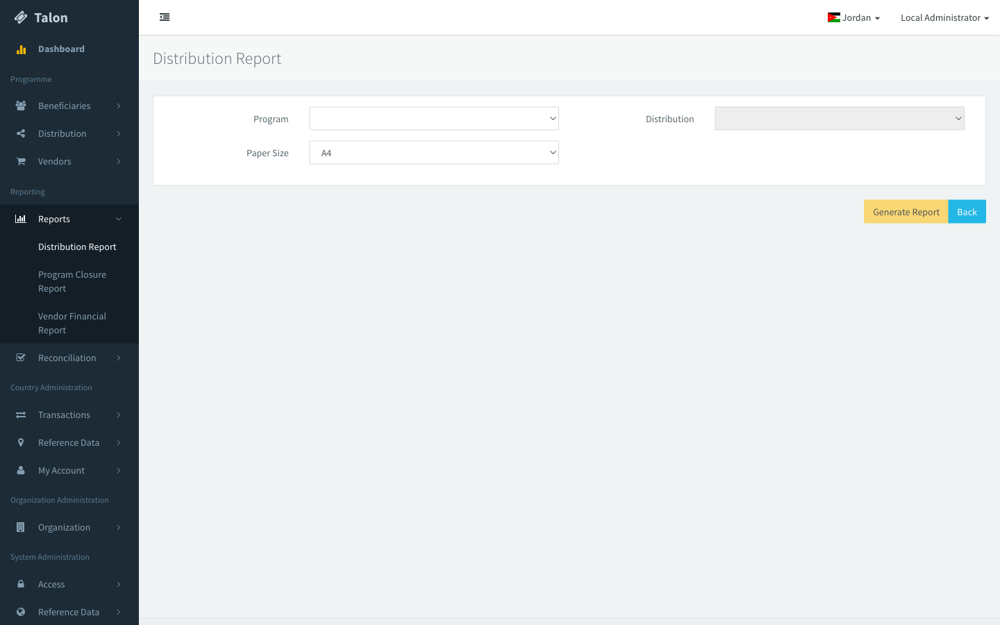

The distribution report renders through Razor and headless Chromium. Every household appears with
both vouchers, the five redemptions carry their claim codes, and the totals are in JOD.

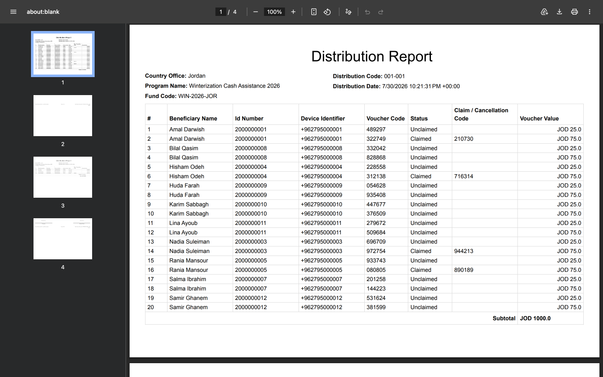

The voucher sheet prints one QR code per voucher — 24 across four pages — labelled with the
household, value and valid-from date. These are rendered by ZXing through SkiaSharp, which
replaced the Windows-only `System.Drawing` path.

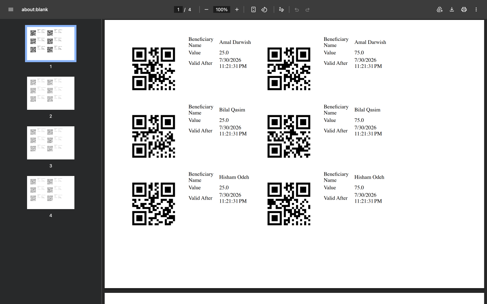

## Reproducing this

The walkthrough was driven through the UI, with bulk records (the extra vendors, the twelve
households, the voucher categories) created through the same Breeze API the client uses. The
equivalent flow runs headlessly in `TalonAdmin.Tests/VoucherDistributionScenarioTests` — it builds
a country, a programme and a cycle, distributes, redeems by SMS and asserts the dashboard and the
report, in about two seconds.
